# RELAY — Engineering Project Memory & Autonomous Continuity Platform

> **Final Round Release &bull; Product Completion & Verification**  
> *People leave. Project knowledge shouldn't.*  
> Transform fragmented commits, pull requests, architectural RFCs, and incident post-mortems into verifiable, evidence-grounded project memory with zero unauthorized leakage.

[](https://nextjs.org)
[](https://www.typescriptlang.org)
[-emerald?style=flat)](file:///tests)
[](https://relay-82oi.onrender.com/)
[](https://gitlab.com/cjwrits/relay)

---

## Live Deployment & Public Links

- **Live Application URL**: [https://relay-82oi.onrender.com/](https://relay-82oi.onrender.com/)
- **1-Click Evaluator Portal**: [https://relay-82oi.onrender.com/login](https://relay-82oi.onrender.com/login)
- **Primary Product Repository (GitLab)**: [https://gitlab.com/cjwrits/relay](https://gitlab.com/cjwrits/relay)
- **Public Mirror Repository (GitHub)**: [https://github.com/CjWrits/Relay](https://github.com/CjWrits/Relay)
- **Target Atlas Demonstration Repository**: [https://gitlab.com/cjwrits/atlas](https://gitlab.com/cjwrits/atlas)
- **Final Technical Dossier (PDF)**: [`docs/RELAY_FINAL_ROUND_DOSSIER.pdf`](docs/RELAY_FINAL_ROUND_DOSSIER.pdf)

---

## What is RELAY?

Software engineering teams lose critical institutional context whenever lead developers transition between teams or leave organizations. Outgoing developers take with them the unwritten rationale behind architectural decisions, unresolved technical conflicts, hidden production migration hazards, single-person operational dependencies, and unassigned maintenance tasks.

Traditional approaches fail:
- **Manual documentation and exit interviews** are hastily assembled under time pressure, quickly grow stale, and reflect only what departing developers remember to write down.
- **Generic AI chat summarizers** hallucinate facts, smooth over critical contradictions, merge public and restricted data without permission awareness, and provide zero auditable citations.
- **Task trackers** show superficial statuses without explaining *why* technical trade-offs were made or what landmines await successors.

**RELAY** reconstructs empirical project memory directly from authoritative development artifacts (GitLab commits, merge requests, issues, technical specs, incident logs), enforces strict source-level access control, and compiles verifiable, role-specific handovers that allow incoming engineers to continue projects independently on Day 1.

---

## The Three Mandatory Round 3 Improvements

In accordance with our Round 2 commitments, the final release of RELAY delivers three complete, auditable improvements:

```mermaid
flowchart TD
    subgraph Imp1 ["IMPROVEMENT 1: TRUST & ACCESS CONTROL"]
        AUTH["Dedicated /login Gateway<br/>1-Click Demo Profiles"] --> SRV["Server-Side Authorization<br/>canAccessSourceActivity()"]
        SRV --> LEAK["Zero-Leakage Engine<br/>filterRestrictedClaims()<br/>Excludes Incident #11 for Maya"]
    end

    subgraph Imp2 ["IMPROVEMENT 2: EVIDENCE GOVERNANCE"]
        DIM["3-Dimensional Verification<br/>Evidence Validity (VALID)<br/>Claim Verification (CONFLICTING)<br/>Resolution Status (UNRESOLVED)"] --> ADJ["Conflict Adjudication<br/>SSE vs WS & Bloom vs DB"]
        ADJ --> LIFE["Handover Lifecycle State Machine<br/>DRAFT &rarr; UNDER_REVIEW &rarr; APPROVED &rarr; SHARED &rarr; ACKNOWLEDGED"]
        LIFE --> VER["Immutable Version Snapshots<br/>Cryptographic Fingerprints"]
    end

    subgraph Imp3 ["IMPROVEMENT 3: INTELLIGENT CONTINUATION"]
        ROLE["Role-Specific Workspaces<br/>DEVELOPER &bull; PM &bull; ADMIN"] --> RADAR["Day-1 Action Radar<br/>Ranked by Blocker Severity<br/>Grounded in Verified Citations"]
        RADAR --> GAP["Explicit Ownership Gaps<br/>Worker Queue DLQ Marked UNASSIGNED"]
        GAP --> ACK["Persistent Digital Receipt<br/>Recipient, Version & Fingerprint<br/>Survives Browser Refreshes"]
    end
```



---

## Quick Start (Zero-Configuration Local Mode)

RELAY comes **preloaded with the synthetic Meridian Project Atlas dataset**. Evaluators can clone, test, build, and run the entire application locally with **zero external API keys, cloud accounts, or database setup**:

```bash
# 1. Clone the repository
git clone https://gitlab.com/cjwrits/relay.git
cd relay

# 2. Install dependencies
npm install

# 3. Run all 71 automated test specifications (8 test suites)
npm test

# 4. Verify TypeScript and ESLint compliance (0 errors)
npx tsc --noEmit --incremental false
npm run lint

# 5. Build and start production server
npm run build
npm start
```

Open [http://localhost:3000](http://localhost:3000) or navigate directly to the live deployment at [https://relay-82oi.onrender.com/](https://relay-82oi.onrender.com/).

---

## Demonstration Accounts & First-Time Judge Experience

When opening the application, visit [`/login`](https://relay-82oi.onrender.com/login) to explore the **1-Click Demo Login Portal**. Judges can instantly switch between three preconfigured synthetic identities:

| Profile | User & Role | Responsibilities & What Evaluators Can Test |
| :--- | :--- | :--- |
| 👔 **Admin** | **Marcus Vance**<br/>`ADMIN`<br/>*VP of Engineering* | • Unrestricted access to all sources including `RESTRICTED` Incident #11.<br/>• Connect & sync live GitLab repositories and upload markdown/text docs.<br/>• Trigger memory reconstruction and share approved handovers with incoming members. |
| 🔍 **Reviewer** | **Elena Rostova**<br/>`REVIEWER`<br/>*Lead Engineer & Reviewer* | • Inspect the 3D Evidence Ledger and verify authentic quotations.<br/>• Adjudicate conflicting decisions (SSE vs WS, Bloom Filter vs Postgres timestamp).<br/>• Formally review, request revisions on, or approve handover drafts. |
| 🚀 **Incoming Member** | **Maya Chen**<br/>`INCOMING_MEMBER`<br/>*Senior Engineer (Taking Over)* | • **Zero Information Leakage**: Restricted incident data is automatically filtered out from her views, APIs, and citations.<br/>• Access the role-specific Continuation Workspace with Day-1 prioritized blockers.<br/>• Sign and persist the formal handover receipt acknowledgment. |

---

## 10-Step Evaluation Walkthrough Guide

Follow this guided walkthrough on the live deployment [https://relay-82oi.onrender.com/](https://relay-82oi.onrender.com/) or locally:

| Step | Route | What Evaluators Can Inspect |
| :---: | :--- | :--- |
| **1** | [`/login`](https://relay-82oi.onrender.com/login) | **Demo Login Portal**: One-click authentication as Marcus (Admin), Elena (Reviewer), or Maya (Incoming Member). Cryptographically signed HttpOnly cookie is issued. |
| **2** | [`/`](https://relay-82oi.onrender.com/) | **Continuity Dashboard**: 4-step workflow guide, explainable Continuity Score (78%), quick handover status, and critical risk radar. |
| **3** | [`/sources`](https://relay-82oi.onrender.com/sources) | **Source Connectors**: 4 preloaded sources, normalized GitLab commits/MRs/issues, drag-and-drop document uploader with line-number preservation. |
| **4** | [`/memory`](https://relay-82oi.onrender.com/memory) | **Project Memory Engine**: Deterministic extraction of 5 decisions, 5 tasks, 3 risks, 4 dependencies, and 3 knowledge gaps from 18 activities. |
| **5** | [`/evidence`](https://relay-82oi.onrender.com/evidence) | **Evidence Ledger & Human Governance**: 3 separate verification dimensions (`evidenceValidity`, `claimVerification`, `resolutionStatus`). Reviewer conflict adjudication for SSE vs WebSockets (`CLM-ATLAS-003`) and Bloom Filter vs Postgres Timestamp (`CLM-ATLAS-009`). |
| **6** | [`/timeline`](https://relay-82oi.onrender.com/timeline) | **Project Timeline**: Chronological multi-source feed with filter toggles and evidence modal inspection. |
| **7** | [`/knowledge-graph`](https://relay-82oi.onrender.com/knowledge-graph) | **Ontology Knowledge Graph**: Interactive force-directed React Flow graph mapping entities, dependencies, contradictions, and module ownership. |
| **8** | [`/handovers`](https://relay-82oi.onrender.com/handovers) | **Handover Studio & Review Lifecycle**: 13-section structured handover document transferring Atlas ownership from Arjun to Maya with full lifecycle controls (`DRAFT` &rarr; `UNDER_REVIEW` &rarr; `APPROVED` &rarr; `SHARED`). |
| **9** | [`/continuation`](https://relay-82oi.onrender.com/continuation) | **Continuation Workspace**: Maya's Day-1 Action Radar ranking critical blockers (e.g. Liam's PR splitting `v2.4_migration.sql` to avoid table locking). Dynamic role switcher (`DEVELOPER`, `PROJECT_MANAGER`, `ADMINISTRATOR`) and persistent receipt sign-off. |
| **10** | [`/settings/access`](https://relay-82oi.onrender.com/settings/access) | **RBAC Matrix & Audit Trail**: Role-based permissions breakdown and immutable audit log capturing every governance event. |

---

## Automated Test Suite (71 Passing Specifications)

RELAY's test suite covers ingestion resilience, deterministic memory reconstruction, security authorization, evidence governance, and continuation persistence:

```bash
$ npm test

▶ Phase 1.5 Synthetic Atlas Foundation Validation (7 tests passed)
▶ Phase 2 Ingestion System — Automated Test Suite (15 tests passed)
▶ Phase 3 Intelligence & Project Memory Reconstruction (20 tests passed)
▶ Round 3 Mandatory Improvements — Automated Test Suite (24 tests passed)
  ▶ Improvement 1: Trust & Access Control (6 tests passed)
  ▶ Improvement 2: Evidence Governance & Lifecycle (8 tests passed)
  ▶ Improvement 3: Intelligent Continuation (6 tests passed)
  ▶ Security Verification: Cryptographic Token Signing & Rejection (4 tests passed)
▶ End-to-End API Security & Zero-Trust Verification (5 tests passed)
  ✔ 1. rejects unauthenticated requests to protected endpoints with HTTP 401
  ✔ 2. sets cryptographically signed HttpOnly cookie upon login
  ✔ 3. allows Marcus to access restricted sources using his verified signed session
  ✔ 4. strictly blocks Maya Chen from accessing restricted sources even if she spoofs headers
  ✔ 5. prevents double-acknowledgement from fabricating inconsistent records (idempotency)

ℹ tests 71
ℹ suites 8
ℹ pass 71
ℹ fail 0
ℹ duration_ms ~770ms
```

---

## Technical Specifications & Persistence Architecture

- **Framework**: Next.js 16.4.5 (App Router, Turbopack)
- **Language**: TypeScript 5.x (Strict typing, 0 errors)
- **Styling**: Tailwind CSS
- **Visualization**: React Flow (`@xyflow/react`)
- **Icons**: Lucide React
- **Persistence Architecture**: Dual-mode engine supporting an in-memory deterministic simulation with persistent browser refresh resilience, and a forward-compatible Supabase PostgreSQL schema with Row Level Security (RLS) migrations.
- **Persistence Scope Disclosure**: In demonstration mode, active state (approvals, versions, acknowledgements) is preserved in server process memory and browser session storage during evaluation. A cold server restart resets demonstration state to baseline. Multi-instance durable production persistence is designed for Supabase PostgreSQL with Row-Level Security via configured environment variables.
- **Repository**: [https://gitlab.com/cjwrits/relay](https://gitlab.com/cjwrits/relay)
- **License**: MIT
