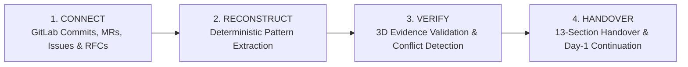

# RELAY — Engineering Project Memory & Autonomous Continuity Engine

> **Round 2 Prototype | Stage 1 Freeze**  
> *Transform raw commits, merge requests, architectural RFCs, and incident post-mortems into verifiable, evidence-grounded project memory.*

[](https://nextjs.org)
[](https://www.typescriptlang.org)
[](file:///tests)
[-teal?style=flat)](https://gitlab.com/cjwrits/relay)

---

## What is RELAY?

Software engineering teams lose critical institutional knowledge whenever lead developers transition between teams or leave companies. Conventional documentation goes stale, while generic AI chat tools hallucinate and collapse architectural trade-offs.

**RELAY** reconstructs empirical project memory directly from authoritative software development artifacts:
1. **Multi-Source Ingestion**: Normalizes GitLab commits, merge requests, issues, and technical markdown/text specs with cryptographic provenance and line-number anchors.
2. **Deterministic Intelligence**: Operates 100% offline without external AI API dependencies, discovering decisions, unfinished tasks, risks, dependencies, and explicit knowledge gaps.
3. **Evidence Validation Ledger**: Every claim is verified against verbatim source quotations. Contradictions (e.g. SSE vs. WebSockets) are preserved rather than falsely smoothed over.
4. **Continuation Workspace**: Gives incoming engineers (such as Maya Chen taking over from Arjun Mehta) a prioritized Day-1 Action Radar with blocker severity rankings.

---

## 4-Step Continuity Architecture



---

## Quick Start (Evaluation Mode)

The prototype comes **preloaded with the synthetic Meridian Project Atlas dataset**. Evaluators can clone, build, and test the complete application locally with **zero external API keys or database configuration**:

```bash
# 1. Clone the repository
git clone https://gitlab.com/cjwrits/relay.git
cd relay

# 2. Install dependencies
npm install

# 3. Run automated tests (42 tests across Phase 1.5, Phase 2, Phase 3)
npm test

# 4. Build and start production server
npm run build
npm start
```

Open [http://localhost:3000](http://localhost:3000) in your browser.

---

## Evaluation Walkthrough Guide

| Step | Page | What Evaluators Can Inspect |
| :--- | :--- | :--- |
| **1. Overview & Workflow** | [`/`](http://localhost:3000/) | 4-step walkthrough header, project continuity indicator (68%), and quick handover banner. |
| **2. Source Connectors** | [`/sources`](http://localhost:3000/sources) | 4 preloaded sources, normalized GitLab commits/MRs/issues, live document uploader (.md/.txt), and connection dialogs. |
| **3. Project Memory** | [`/memory`](http://localhost:3000/memory) | 5 decisions, 5 tasks, 3 risks, 4 dependencies, and 3 knowledge gaps with full entity resolution. |
| **4. Evidence Ledger** | [`/evidence`](http://localhost:3000/evidence) | 11 grounded claims with exact quotations and line anchors. Preserves active contradictions (`CLM-ATLAS-003` SSE vs. WS) and flags missing evidence. |
| **5. Timeline & Graph** | [`/timeline`](http://localhost:3000/timeline) & [`/knowledge-graph`](http://localhost:3000/knowledge-graph) | Chronological activity stream and interactive force-directed ontology graph. |
| **6. Handover Studio** | [`/handovers`](http://localhost:3000/handovers) | 13-section structured handover document transferring Atlas ownership from Arjun to Maya with role-specific views. |
| **7. Continuation Hub** | [`/continuation`](http://localhost:3000/continuation) | Maya's Day-1 Action Radar ranking critical blockers (e.g. Liam's PR splitting `v2.4_migration.sql` to avoid table locking). |

---

## Automated Test Suite

All 42 automated tests pass with 0 failures:

```bash
$ npm test

▶ Phase 1.5 Synthetic Atlas Foundation Validation (7 tests passed)
▶ Phase 2 Ingestion System — Automated Test Suite (15 tests passed)
▶ Phase 3 Intelligence & Project Memory Reconstruction (20 tests passed)

ℹ tests 42
ℹ pass 42
ℹ fail 0
ℹ duration_ms ~640ms
```

---

## Technical Specifications

- **Framework**: Next.js 16.4.5 (App Router, Turbopack)
- **Language**: TypeScript 5.x
- **Styling**: Tailwind CSS
- **Visualization**: React Flow (`@xyflow/react`)
- **Persistence Architecture**: Dual-mode engine supporting in-memory deterministic simulation and Supabase PostgreSQL with Row Level Security (RLS).
- **Repository**: [https://gitlab.com/cjwrits/relay](https://gitlab.com/cjwrits/relay)
