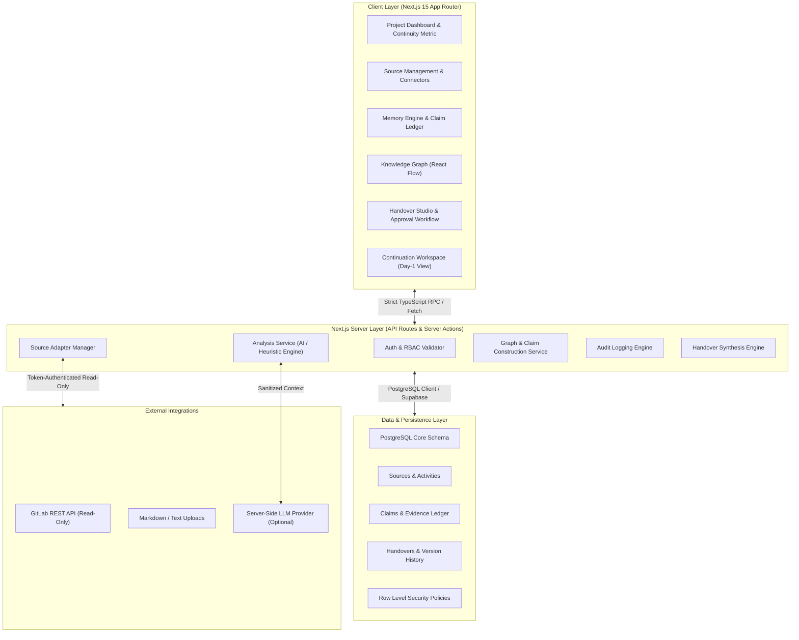

# RELAY — System Architecture & Design
## Evidence-Backed Project Continuity & Intelligent Handover Platform

---

## 1. Architectural Philosophy & Design Principles

RELAY is engineered to prevent knowledge attrition when team members depart projects. Unlike generic AI wrappers or passive documentation sites, RELAY is built around four architectural guarantees:

1. **Strict Source Grounding:** No inference or claim is admitted into the platform memory without an explicit reference to at least one immutable source record (commit, issue, merge request, or document excerpt).
2. **Deterministic Fallback (Zero-Cold-Start):** While supporting state-of-the-art LLMs through server-side environment configuration, RELAY operates seamlessly in a deterministic demonstration mode using heuristic knowledge-extraction pipelines. It never requires paid API keys to function.
3. **Role & Source-Aware Privacy:** Knowledge inheritance is strictly filtered by source access classification. Summaries derived from restricted sources never leak across access boundaries.
4. **Human-in-the-Loop Governance:** Autonomous AI generation is confined to draft proposal states. Every handover must be reviewed, edited, and explicitly approved by authorized human leads.

---

## 2. High-Level System Architecture



---

## 3. Core Architectural Subsystems

### 3.1 Ingestion & Source Adapter Architecture
The ingestion layer is designed to be completely decoupled from data processing via the `SourceAdapter` interface.

```typescript
export interface SourceAdapter {
  id: string;
  sourceType: 'GITLAB' | 'GITHUB' | 'DOCUMENT' | 'CUSTOM';
  validateCredentials(config: SourceConfig): Promise<boolean>;
  fetchActivities(config: SourceConfig, since?: Date): Promise<RawSourceActivity[]>;
  fetchDocumentContent(config: SourceConfig, documentId: string): Promise<RawDocumentContent>;
}
```

- **GitLab REST API Adapter:** Connects using read-only personal or project access tokens. Pulls commits, issues, comments, merge requests, and repository markdown files.
- **Document Ingestion Adapter:** Handles `.md` and `.txt` files. Employs frontmatter parsing, heading tree extraction, and text chunking with deterministic hash IDs for excerpt anchoring.
- **Extensible Registry:** Allows adding GitHub, Jira, or Slack adapters without altering memory extraction logic.

### 3.2 Analysis & Memory Reconstruction Engine
The analysis service operates on an abstract provider pattern:

```typescript
export interface AnalysisProvider {
  extractDecisions(activities: RawSourceActivity[]): Promise<ExtractedDecision[]>;
  extractResponsibilities(activities: RawSourceActivity[]): Promise<ExtractedOwnership[]>;
  extractRisks(activities: RawSourceActivity[]): Promise<ExtractedRisk[]>;
  extractDependencies(activities: RawSourceActivity[]): Promise<ExtractedDependency[]>;
  extractUnfinishedWork(activities: RawSourceActivity[]): Promise<ExtractedTask[]>;
}
```

- **Hybrid Analysis Pipeline:**
  1. **Pattern & Heuristic Parser (Deterministic):** Identifies conventional commit prefixes (`feat:`, `fix:`, `refactor:`), issue tags, markdown headers (`### Architecture Decisions`), and blocker syntax (`BLOCKED BY:`, `TODO:`, `FIXME:`, `RISK:`).
  2. **LLM Provider (Configurable Server-Side):** When an API key (e.g. Gemini, OpenAI, or Anthropic) is provided in `.env.local`, deep relational reasoning and cross-document synthesis are activated.
  3. **Demarcation Guarantee:** The UI visibly tags whether each claim was extracted via deterministic analysis or LLM inference.

### 3.3 Evidence & Confidence Ledger
Every extracted fact is transformed into an immutable `Claim` record linked to one or more `ClaimEvidence` records:

- **Claim Anatomy:**
  - `id`: Unique identifier (e.g., `CLM-001`).
  - `subject`: Entity affected (e.g., `Authentication Module`).
  - `predicate`: Relationship or assertion (e.g., `chosen_over`).
  - `object`: Entity or rationale (e.g., `Session Cookies due to stateless mobile client requirements`).
  - `status`: `VERIFIED` | `UNCERTAIN` | `CONFLICTING` | `UNVERIFIED`.
  - `confidence`: Calibrated float (0.00 – 1.00).

- **Conflict Detection:**
  When two source activities assert contradictory statements regarding the same subject (e.g., Issue #14 stating "WebSocket for events" vs. Commit `8b32e1` removing WebSockets in favor of SSE), the engine flags both claims with status `CONFLICTING` and links them to an unresolved review item.

### 3.4 Project Knowledge Graph (React Flow)
- Dynamic graph generation converting entities (`Person`, `Module`, `Decision`, `Risk`, `Task`, `UnresolvedQuestion`) into interactive nodes.
- Topological layout calculation that places modules at the center, surrounded by decision nodes, risk alerts, and contributing engineers.
- Interactive side-drawer that displays the full evidence trace upon clicking any node or edge.

### 3.5 Role-Based Handover Studio & Approval Lifecycle
Handovers follow an explicit state machine:
$$\text{DRAFT} \xrightarrow{\text{Submit for Review}} \text{IN\_REVIEW} \xrightarrow{\text{Admin/Lead Review}} \text{APPROVED} \xrightarrow{\text{Maya Acknowledges}} \text{ACKNOWLEDGED}$$

- **Role Filtering at Synthesis Time:**
  - **Incoming Developer:** Gets architectural decisions, code paths, unresolved PRs, build steps, and migration caveats.
  - **Project Manager:** Gets ownership gaps, delivery risks, team blockers, and milestone dependencies.
  - **Lead / Reviewer:** Gets full diff of claims, conflict highlights, and review approval controls.

---

## 4. Frontend Design System & Technology Stack

- **Framework:** Next.js 15+ App Router, React 19.
- **Language:** TypeScript with `strict: true`.
- **Styling:** Tailwind CSS v4, custom utility abstractions.
- **Color Palette:**
  - Base: Crisp Slate/Zinc neutrals (`bg-white`, `bg-slate-50`, `text-slate-900`, `border-slate-200`).
  - Primary Accent: Precision Teal (`#0D9488` / `teal-600`) symbolizing clarity and continuity.
  - Secondary Accent: Deep Indigo (`#4F46E5` / `indigo-600`) for structural elements.
  - Status Accents: Emerald (`VERIFIED`), Amber (`UNCERTAIN`), Rose (`CONFLICTING`), Slate (`UNVERIFIED`).
- **Icons:** `lucide-react`.
- **Graphing:** `@xyflow/react` (React Flow) with customized node components and pan/zoom navigation.
- **Accessibility:** Semantic HTML5, full keyboard navigation, accessible color contrast ratios exceeding WCAG AA.

---

## 5. Security & Threat Mitigation Architecture

1. **Untrusted Data Isolation:**
   All imported commits, PR descriptions, and markdown documents are strictly treated as untrusted text payloads. They are never executed, evaluated as code, or interpolated unescaped into DOM or AI prompt instructions.

2. **Prompt Injection Defense:**
   System prompts enforce delimiter fences (e.g. `<<<UNTRUSTED_SOURCE_START>>>`) and strict instructions forbidding the LLM from executing commands found within ingested repository contents.

3. **Source Classification Cascading:**
   Every activity inherits a security clearance from its parent source (`PUBLIC`, `INTERNAL`, `RESTRICTED`, `CONFIDENTIAL`). Generated summaries and handovers verify the viewer's clearance before rendering any section or linked claim.
