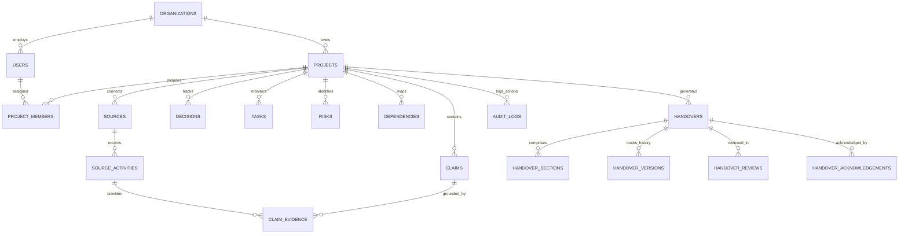

# RELAY — Relational Database Schema & Migrations
## Evidence-Backed Project Continuity & Intelligent Handover Platform

---

## 1. Schema Architecture Overview

RELAY relies on a normalized PostgreSQL schema designed for high relational integrity, auditable evidence tracing, and strict multi-tenant Row Level Security (RLS).

The schema is structured into six functional domains:
1. **Tenancy & Access Control:** `organizations`, `users`, `projects`, `project_members`, `source_access_policies`
2. **Ingested Sources & Activities:** `sources`, `source_activities`, `people`
3. **Reconstructed Memory Entities:** `decisions`, `tasks`, `risks`, `dependencies`, `project_events`
4. **Evidence & Grounding Engine:** `claims`, `claim_evidence`
5. **Handover Lifecycle & Governance:** `handovers`, `handover_sections`, `handover_versions`, `handover_reviews`, `handover_acknowledgements`
6. **Audit & Compliance:** `audit_logs`

---

## 2. Entity Relationship Model



---

## 3. Complete PostgreSQL DDL (Data Definition Language)

```sql
-- Enable necessary extensions
CREATE EXTENSION IF NOT EXISTS "uuid-ossp";
CREATE EXTENSION IF NOT EXISTS "pgcrypto";

-- ============================================================================
-- 1. TENANCY & USERS
-- ============================================================================

CREATE TABLE organizations (
    id UUID PRIMARY KEY DEFAULT gen_random_uuid(),
    name VARCHAR(255) NOT NULL,
    slug VARCHAR(100) UNIQUE NOT NULL,
    created_at TIMESTAMPTZ DEFAULT NOW() NOT NULL,
    updated_at TIMESTAMPTZ DEFAULT NOW() NOT NULL
);

CREATE TABLE users (
    id UUID PRIMARY KEY DEFAULT gen_random_uuid(),
    org_id UUID REFERENCES organizations(id) ON DELETE CASCADE,
    email VARCHAR(255) UNIQUE NOT NULL,
    full_name VARCHAR(255) NOT NULL,
    avatar_url TEXT,
    system_role VARCHAR(50) DEFAULT 'MEMBER' CHECK (system_role IN ('GLOBAL_ADMIN', 'MEMBER')),
    created_at TIMESTAMPTZ DEFAULT NOW() NOT NULL,
    updated_at TIMESTAMPTZ DEFAULT NOW() NOT NULL
);

CREATE TABLE projects (
    id UUID PRIMARY KEY DEFAULT gen_random_uuid(),
    org_id UUID REFERENCES organizations(id) ON DELETE CASCADE NOT NULL,
    name VARCHAR(255) NOT NULL,
    slug VARCHAR(100) NOT NULL,
    description TEXT,
    repository_url TEXT,
    status VARCHAR(50) DEFAULT 'ACTIVE' CHECK (status IN ('ACTIVE', 'ARCHIVED', 'PAUSED')),
    created_at TIMESTAMPTZ DEFAULT NOW() NOT NULL,
    updated_at TIMESTAMPTZ DEFAULT NOW() NOT NULL,
    UNIQUE(org_id, slug)
);

CREATE TABLE project_members (
    id UUID PRIMARY KEY DEFAULT gen_random_uuid(),
    project_id UUID REFERENCES projects(id) ON DELETE CASCADE NOT NULL,
    user_id UUID REFERENCES users(id) ON DELETE CASCADE NOT NULL,
    project_role VARCHAR(50) DEFAULT 'INCOMING_MEMBER' CHECK (project_role IN ('ADMIN', 'REVIEWER', 'INCOMING_MEMBER')),
    joined_at TIMESTAMPTZ DEFAULT NOW() NOT NULL,
    UNIQUE(project_id, user_id)
);

-- ============================================================================
-- 2. SOURCES & ACCESS POLICIES
-- ============================================================================

CREATE TABLE sources (
    id UUID PRIMARY KEY DEFAULT gen_random_uuid(),
    project_id UUID REFERENCES projects(id) ON DELETE CASCADE NOT NULL,
    source_type VARCHAR(50) NOT NULL CHECK (source_type IN ('GITLAB', 'GITHUB', 'DOCUMENT', 'TXT_UPLOAD')),
    name VARCHAR(255) NOT NULL,
    external_id TEXT,
    external_url TEXT,
    default_access_level VARCHAR(50) DEFAULT 'INTERNAL' CHECK (default_access_level IN ('PUBLIC', 'INTERNAL', 'RESTRICTED', 'CONFIDENTIAL')),
    last_synced_at TIMESTAMPTZ,
    sync_status VARCHAR(50) DEFAULT 'IDLE' CHECK (sync_status IN ('IDLE', 'SYNCING', 'SUCCESS', 'FAILED')),
    sync_error_message TEXT,
    created_at TIMESTAMPTZ DEFAULT NOW() NOT NULL,
    updated_at TIMESTAMPTZ DEFAULT NOW() NOT NULL
);

CREATE TABLE source_access_policies (
    id UUID PRIMARY KEY DEFAULT gen_random_uuid(),
    source_id UUID REFERENCES sources(id) ON DELETE CASCADE NOT NULL,
    required_role VARCHAR(50) NOT NULL CHECK (required_role IN ('ADMIN', 'REVIEWER', 'INCOMING_MEMBER')),
    allowed_access_levels TEXT[] NOT NULL DEFAULT ARRAY['PUBLIC', 'INTERNAL'],
    created_at TIMESTAMPTZ DEFAULT NOW() NOT NULL
);

CREATE TABLE people (
    id UUID PRIMARY KEY DEFAULT gen_random_uuid(),
    project_id UUID REFERENCES projects(id) ON DELETE CASCADE NOT NULL,
    name VARCHAR(255) NOT NULL,
    email VARCHAR(255),
    gitlab_username VARCHAR(100),
    avatar_url TEXT,
    primary_role VARCHAR(100),
    is_active BOOLEAN DEFAULT TRUE,
    created_at TIMESTAMPTZ DEFAULT NOW() NOT NULL
);

CREATE TABLE source_activities (
    id UUID PRIMARY KEY DEFAULT gen_random_uuid(),
    source_id UUID REFERENCES sources(id) ON DELETE CASCADE NOT NULL,
    activity_type VARCHAR(50) NOT NULL CHECK (activity_type IN ('COMMIT', 'ISSUE', 'MERGE_REQUEST', 'ISSUE_COMMENT', 'DOCUMENT_CHUNK')),
    external_reference_id VARCHAR(255) NOT NULL,
    title TEXT NOT NULL,
    content_body TEXT NOT NULL,
    author_name VARCHAR(255) NOT NULL,
    author_email VARCHAR(255),
    author_id UUID REFERENCES people(id) ON DELETE SET NULL,
    access_level VARCHAR(50) DEFAULT 'INTERNAL' CHECK (access_level IN ('PUBLIC', 'INTERNAL', 'RESTRICTED', 'CONFIDENTIAL')),
    activity_timestamp TIMESTAMPTZ NOT NULL,
    external_url TEXT,
    metadata JSONB DEFAULT '{}'::jsonb,
    created_at TIMESTAMPTZ DEFAULT NOW() NOT NULL
);

-- ============================================================================
-- 3. EVIDENCE & GROUNDING ENGINE
-- ============================================================================

CREATE TABLE claims (
    id UUID PRIMARY KEY DEFAULT gen_random_uuid(),
    project_id UUID REFERENCES projects(id) ON DELETE CASCADE NOT NULL,
    claim_code VARCHAR(50) UNIQUE NOT NULL, -- e.g. CLM-ATLAS-001
    claim_text TEXT NOT NULL,
    category VARCHAR(50) NOT NULL CHECK (category IN ('DECISION', 'TASK', 'RISK', 'DEPENDENCY', 'OWNERSHIP', 'UNRESOLVED_QUESTION')),
    verification_status VARCHAR(50) DEFAULT 'UNVERIFIED' CHECK (verification_status IN ('VERIFIED', 'UNCERTAIN', 'CONFLICTING', 'UNVERIFIED')),
    confidence_score NUMERIC(4,3) DEFAULT 0.500 CHECK (confidence_score >= 0.0 AND confidence_score <= 1.0),
    inference_type VARCHAR(50) DEFAULT 'HEURISTIC' CHECK (inference_type IN ('DIRECT_EVIDENCE', 'HEURISTIC', 'LLM_INFERRED', 'HUMAN_ENTERED')),
    conflict_notes TEXT,
    created_at TIMESTAMPTZ DEFAULT NOW() NOT NULL,
    updated_at TIMESTAMPTZ DEFAULT NOW() NOT NULL
);

CREATE TABLE claim_evidence (
    id UUID PRIMARY KEY DEFAULT gen_random_uuid(),
    claim_id UUID REFERENCES claims(id) ON DELETE CASCADE NOT NULL,
    activity_id UUID REFERENCES source_activities(id) ON DELETE CASCADE NOT NULL,
    excerpt TEXT NOT NULL,
    line_reference VARCHAR(100),
    relevance_explanation TEXT,
    created_at TIMESTAMPTZ DEFAULT NOW() NOT NULL
);

-- ============================================================================
-- 4. RECONSTRUCTED MEMORY ENTITIES
-- ============================================================================

CREATE TABLE decisions (
    id UUID PRIMARY KEY DEFAULT gen_random_uuid(),
    project_id UUID REFERENCES projects(id) ON DELETE CASCADE NOT NULL,
    claim_id UUID REFERENCES claims(id) ON DELETE SET NULL,
    title VARCHAR(255) NOT NULL,
    decision_summary TEXT NOT NULL,
    rationale TEXT NOT NULL,
    alternatives_considered TEXT,
    made_by_id UUID REFERENCES people(id) ON DELETE SET NULL,
    decided_at TIMESTAMPTZ NOT NULL,
    status VARCHAR(50) DEFAULT 'ACTIVE' CHECK (status IN ('ACTIVE', 'SUPERSEDED', 'DEPRECATED')),
    created_at TIMESTAMPTZ DEFAULT NOW() NOT NULL
);

CREATE TABLE tasks (
    id UUID PRIMARY KEY DEFAULT gen_random_uuid(),
    project_id UUID REFERENCES projects(id) ON DELETE CASCADE NOT NULL,
    claim_id UUID REFERENCES claims(id) ON DELETE SET NULL,
    title VARCHAR(255) NOT NULL,
    description TEXT,
    status VARCHAR(50) DEFAULT 'OPEN' CHECK (status IN ('OPEN', 'IN_PROGRESS', 'BLOCKED', 'COMPLETED', 'ABANDONED')),
    priority VARCHAR(50) DEFAULT 'MEDIUM' CHECK (priority IN ('LOW', 'MEDIUM', 'HIGH', 'CRITICAL')),
    assignee_id UUID REFERENCES people(id) ON DELETE SET NULL,
    external_task_url TEXT,
    created_at TIMESTAMPTZ DEFAULT NOW() NOT NULL
);

CREATE TABLE risks (
    id UUID PRIMARY KEY DEFAULT gen_random_uuid(),
    project_id UUID REFERENCES projects(id) ON DELETE CASCADE NOT NULL,
    claim_id UUID REFERENCES claims(id) ON DELETE SET NULL,
    title VARCHAR(255) NOT NULL,
    severity VARCHAR(50) DEFAULT 'MEDIUM' CHECK (severity IN ('LOW', 'MEDIUM', 'HIGH', 'CRITICAL')),
    mitigation_strategy TEXT,
    status VARCHAR(50) DEFAULT 'ACTIVE' CHECK (status IN ('ACTIVE', 'MITIGATED', 'ACCEPTED')),
    identified_at TIMESTAMPTZ DEFAULT NOW() NOT NULL,
    created_at TIMESTAMPTZ DEFAULT NOW() NOT NULL
);

CREATE TABLE dependencies (
    id UUID PRIMARY KEY DEFAULT gen_random_uuid(),
    project_id UUID REFERENCES projects(id) ON DELETE CASCADE NOT NULL,
    source_entity_name VARCHAR(255) NOT NULL,
    target_entity_name VARCHAR(255) NOT NULL,
    dependency_type VARCHAR(50) DEFAULT 'TECHNICAL' CHECK (dependency_type IN ('TECHNICAL', 'DATA', 'OPERATIONAL', 'TEAM')),
    description TEXT,
    is_blocking BOOLEAN DEFAULT FALSE,
    created_at TIMESTAMPTZ DEFAULT NOW() NOT NULL
);

CREATE TABLE project_events (
    id UUID PRIMARY KEY DEFAULT gen_random_uuid(),
    project_id UUID REFERENCES projects(id) ON DELETE CASCADE NOT NULL,
    activity_id UUID REFERENCES source_activities(id) ON DELETE SET NULL,
    event_type VARCHAR(50) NOT NULL CHECK (event_type IN ('COMMIT', 'ISSUE_OPEN', 'ISSUE_CLOSE', 'MR_MERGE', 'DECISION_MADE', 'RISK_FLAGGED')),
    title VARCHAR(255) NOT NULL,
    description TEXT,
    actor_id UUID REFERENCES people(id) ON DELETE SET NULL,
    event_timestamp TIMESTAMPTZ NOT NULL,
    created_at TIMESTAMPTZ DEFAULT NOW() NOT NULL
);

-- ============================================================================
-- 5. HANDOVERS & GOVERNANCE
-- ============================================================================

CREATE TABLE handovers (
    id UUID PRIMARY KEY DEFAULT gen_random_uuid(),
    project_id UUID REFERENCES projects(id) ON DELETE CASCADE NOT NULL,
    title VARCHAR(255) NOT NULL,
    departing_member_id UUID REFERENCES people(id) ON DELETE RESTRICT NOT NULL,
    incoming_member_id UUID REFERENCES people(id) ON DELETE RESTRICT NOT NULL,
    target_role VARCHAR(50) DEFAULT 'INCOMING_DEVELOPER' CHECK (target_role IN ('INCOMING_DEVELOPER', 'PROJECT_MANAGER', 'SECURITY_LEAD')),
    status VARCHAR(50) DEFAULT 'DRAFT' CHECK (status IN ('DRAFT', 'IN_REVIEW', 'APPROVED', 'REJECTED', 'ACKNOWLEDGED')),
    created_by UUID REFERENCES users(id) ON DELETE SET NULL,
    scope VARCHAR(100) DEFAULT 'FULL_PROJECT',
    created_at TIMESTAMPTZ DEFAULT NOW() NOT NULL,
    updated_at TIMESTAMPTZ DEFAULT NOW() NOT NULL
);

CREATE TABLE handover_sections (
    id UUID PRIMARY KEY DEFAULT gen_random_uuid(),
    handover_id UUID REFERENCES handovers(id) ON DELETE CASCADE NOT NULL,
    section_key VARCHAR(100) NOT NULL, -- e.g. 'ARCHITECTURE_DECISIONS', 'UNFINISHED_TASKS'
    title VARCHAR(255) NOT NULL,
    content_markdown TEXT NOT NULL,
    section_order INT NOT NULL DEFAULT 0,
    created_at TIMESTAMPTZ DEFAULT NOW() NOT NULL,
    updated_at TIMESTAMPTZ DEFAULT NOW() NOT NULL
);

CREATE TABLE handover_versions (
    id UUID PRIMARY KEY DEFAULT gen_random_uuid(),
    handover_id UUID REFERENCES handovers(id) ON DELETE CASCADE NOT NULL,
    version_number INT NOT NULL,
    snapshot_json JSONB NOT NULL,
    changed_by UUID REFERENCES users(id) ON DELETE SET NULL,
    change_summary TEXT NOT NULL,
    created_at TIMESTAMPTZ DEFAULT NOW() NOT NULL
);

CREATE TABLE handover_reviews (
    id UUID PRIMARY KEY DEFAULT gen_random_uuid(),
    handover_id UUID REFERENCES handovers(id) ON DELETE CASCADE NOT NULL,
    reviewer_id UUID REFERENCES users(id) ON DELETE CASCADE NOT NULL,
    verdict VARCHAR(50) NOT NULL CHECK (verdict IN ('APPROVED', 'REQUESTED_CHANGES', 'REJECTED')),
    comments TEXT,
    reviewed_at TIMESTAMPTZ DEFAULT NOW() NOT NULL
);

CREATE TABLE handover_acknowledgements (
    id UUID PRIMARY KEY DEFAULT gen_random_uuid(),
    handover_id UUID REFERENCES handovers(id) ON DELETE CASCADE NOT NULL,
    acknowledged_by UUID REFERENCES users(id) ON DELETE CASCADE NOT NULL,
    confirmation_statement TEXT NOT NULL,
    acknowledged_at TIMESTAMPTZ DEFAULT NOW() NOT NULL
);

-- ============================================================================
-- 6. AUDIT LOGS
-- ============================================================================

CREATE TABLE audit_logs (
    id UUID PRIMARY KEY DEFAULT gen_random_uuid(),
    project_id UUID REFERENCES projects(id) ON DELETE CASCADE,
    actor_id UUID REFERENCES users(id) ON DELETE SET NULL,
    action VARCHAR(100) NOT NULL, -- e.g. 'CLAIM_STATUS_UPDATED', 'HANDOVER_APPROVED'
    entity_type VARCHAR(100) NOT NULL,
    entity_id UUID NOT NULL,
    previous_state JSONB,
    new_state JSONB,
    ip_address VARCHAR(45),
    created_at TIMESTAMPTZ DEFAULT NOW() NOT NULL
);

-- ============================================================================
-- 7. PERFORMANCE INDEXES
-- ============================================================================

CREATE INDEX idx_project_members_proj ON project_members(project_id, user_id);
CREATE INDEX idx_sources_project ON sources(project_id);
CREATE INDEX idx_source_activities_src ON source_activities(source_id, activity_timestamp DESC);
CREATE INDEX idx_claims_project ON claims(project_id, category);
CREATE INDEX idx_claim_evidence_claim ON claim_evidence(claim_id);
CREATE INDEX idx_decisions_proj ON decisions(project_id);
CREATE INDEX idx_tasks_proj ON tasks(project_id, status);
CREATE INDEX idx_risks_proj ON risks(project_id, status);
CREATE INDEX idx_handovers_proj ON handovers(project_id, status);
CREATE INDEX idx_audit_project ON audit_logs(project_id, created_at DESC);
```

---

## 4. Row Level Security (RLS) Policies

All tables employ Supabase Row Level Security to ensure zero cross-organization or cross-project data leakage:

```sql
-- Enable RLS across all tables
ALTER TABLE projects ENABLE ROW LEVEL SECURITY;
ALTER TABLE sources ENABLE ROW LEVEL SECURITY;
ALTER TABLE source_activities ENABLE ROW LEVEL SECURITY;
ALTER TABLE claims ENABLE ROW LEVEL SECURITY;
ALTER TABLE claim_evidence ENABLE ROW LEVEL SECURITY;
ALTER TABLE handovers ENABLE ROW LEVEL SECURITY;
ALTER TABLE audit_logs ENABLE ROW LEVEL SECURITY;

-- Project access policy: Users can only see projects they are members of
CREATE POLICY "Users view projects they belong to"
ON projects FOR SELECT
USING (
    EXISTS (
        SELECT 1 FROM project_members
        WHERE project_members.project_id = projects.id
        AND project_members.user_id = auth.uid()
    )
);

-- Source Activities access: Incoming members cannot see activities from RESTRICTED or CONFIDENTIAL sources
CREATE POLICY "Role-aware source activity access"
ON source_activities FOR SELECT
USING (
    EXISTS (
        SELECT 1 FROM project_members pm
        JOIN sources s ON s.project_id = pm.project_id
        WHERE s.id = source_activities.source_id
        AND pm.user_id = auth.uid()
        AND (
            pm.project_role IN ('ADMIN', 'REVIEWER')
            OR (pm.project_role = 'INCOMING_MEMBER' AND source_activities.access_level IN ('PUBLIC', 'INTERNAL'))
        )
    )
);

-- Handover view policy: Incoming members can ONLY view handovers in APPROVED or ACKNOWLEDGED state
CREATE POLICY "Incoming member view approved handovers only"
ON handovers FOR SELECT
USING (
    EXISTS (
        SELECT 1 FROM project_members pm
        WHERE pm.project_id = handovers.project_id
        AND pm.user_id = auth.uid()
        AND (
            pm.project_role IN ('ADMIN', 'REVIEWER')
            OR (pm.project_role = 'INCOMING_MEMBER' AND handovers.status IN ('APPROVED', 'ACKNOWLEDGED'))
        )
    )
);
```
