# RELAY — Development Roadmap & Phased Execution Plan
## Evidence-Backed Project Continuity & Intelligent Handover Platform

---

## 1. Roadmap Overview & Milestones

The RELAY implementation follows a strict 8-phase disciplined engineering strategy. Each phase establishes verified foundations before progressing, ensuring no technical debt or fake mockups are carried forward.

```mermaid
flowchart LR
    P0["Phase 0: Inspection"] --> P1["Phase 1: Foundation"]
    P1 -->|Review & Signoff| P2["Phase 2: Ingestion"]
    P2 --> P3["Phase 3: Memory Engine"]
    P3 --> P4["Phase 4: Evidence & RBAC"]
    P4 --> P5["Phase 5: Handover Studio"]
    P5 --> P6["Phase 6: Continuation"]
    P6 --> P7["Phase 7: Testing & Polish"]
```

---

## 2. Phase Breakdown & Deliverables

### Phase 0: Workspace Inspection *(Completed)*
- **Objective:** Verify host environment, package managers, git tooling, and workspace prerequisites.
- **Results:**
  - Environment: Node.js `v24.11.0`, npm `11.6.1`, git `2.51.1.windows.1`.
  - Workspace initialized in clean state.
  - Zero conflicting legacy files or rogue processes.

### Phase 1: Product Foundation *(Current Phase)*
- **Objective:** Establish the foundational application shell, relational schema, strict TypeScript contracts, design system, and explainable dashboard.
- **Deliverables:**
  - Full project scaffolding with Next.js 15+ App Router, TypeScript (strict), Tailwind CSS v4, Lucide icons, and React Flow.
  - Core domain models and TypeScript interfaces (`src/types/relay.ts`).
  - PostgreSQL schema documentation and DDL with Row Level Security (`docs/DATABASE_SCHEMA.md`).
  - Security model and prompt defense specifications (`docs/SECURITY_MODEL.md`).
  - Product specifications and user journey definitions (`docs/PRODUCT_SPEC.md`).
  - Hackathon Round 1 submission brief addressing all judging criteria (`docs/ROUND_1_SUBMISSION.md`).
  - App shell with responsive navigation, role-switch simulator, and project selector.
  - Interactive Project Dashboard with an explainable **Project Continuity Index** driven by verifiable factors.
- **Verification Gate:** Review with user before commencing Phase 2.

### Phase 2: Data Ingestion & Source Connectors
- **Objective:** Implement modular source adapters for GitLab and local document uploads.
- **Deliverables:**
  - `SourceAdapter` interface and registry.
  - GitLab REST API client (read-only commits, issues, merge requests).
  - Drag-and-drop document uploader with `.md`/`.txt` validation and 5MB size ceiling.
  - Ingestion progress tracking, error handling, and timestamped synchronization logs.
  - ATLAS synthetic project dataset loader.
- **Verification Gate:** Verify successful ingestion of real GitLab repository test data and markdown documentation chunks.

### Phase 3: Project Memory Reconstruction Engine
- **Objective:** Transform raw activities into structured memory entities.
- **Deliverables:**
  - Extraction pipelines for:
    - Decisions (rationale, alternatives, author, timestamp).
    - Responsibilities (explicit vs. inferred owners, orphan components).
    - Unfinished Work (open issues, draft PRs, commented TODOs).
    - Dependencies (inter-module couplings, third-party libraries).
    - Risks (data migrations, performance bottlenecks, SPOFs).
    - Unresolved Questions (unsettled architectural discussions).
  - Dual-mode analysis: Server-side LLM provider with graceful deterministic heuristic fallback.
  - Interactive chronological Project Timeline with multi-parameter filtering.
  - Interactive Project Knowledge Graph powered by React Flow with custom node designs.
- **Verification Gate:** Verify extracted nodes against raw commits and confirm zero orphan entities.

### Phase 4: Evidence & Confidence Engine + RBAC
- **Objective:** Deliver RELAY's core differentiator: inspectable evidence grounding and security isolation.
- **Deliverables:**
  - Claim Ledger table with live filtering by verification status (`VERIFIED`, `UNCERTAIN`, `CONFLICTING`, `UNVERIFIED`).
  - Evidence Inspector drawer revealing exact source quotes and line numbers.
  - Conflict resolution tool allowing reviewers to adjudicate contradictory sources.
  - Backend authorization enforcement across API routes and server actions.
  - Source-level classification filters preventing permission leakage into summaries.
- **Verification Gate:** Security tests proving an incoming member cannot view restricted activities or unapproved claims.

### Phase 5: Intelligent Handover Studio & Approval Workflow
- **Objective:** Generate role-specific handovers with rigorous human-in-the-loop governance.
- **Deliverables:**
  - Handover synthesis generator with role profiles (Developer, Project Manager, Security Lead).
  - Draft Handover editor with inline claim verification, rejection, and reviewer annotation.
  - State machine transition: `DRAFT` $\rightarrow$ `IN_REVIEW` $\rightarrow$ `APPROVED` $\rightarrow$ `REJECTED`.
  - Immutable version history ledger capturing snapshots and author diffs.
- **Verification Gate:** Verify that unapproved handovers remain strictly invisible to incoming members.

### Phase 6: Continuation Workspace
- **Objective:** Provide the incoming developer (Maya) with a structured Day-1 action plan.
- **Deliverables:**
  - "What should I do first?" prioritized action radar.
  - Grouped tasks linked to technical decisions, dependencies, and blocker alerts.
  - Module owner contact cards and emergency escalation paths.
  - Formal "Acknowledge Receipt & Accept Responsibility" sign-off workflow with audit record creation.
- **Verification Gate:** Complete Maya's end-to-end journey from receiving approved handover to completing first task.

### Phase 7: Testing, Verification & Final Polish
- **Objective:** Full-system integration testing, accessibility compliance, and performance optimization.
- **Deliverables:**
  - Comprehensive unit and integration test suite.
  - Automated access control regression tests.
  - Responsive layout validation across desktop, tablet, and mobile.
  - Production build verification (`npm run build`).
  - Hackathon video presentation script and demonstration walkthrough.
- **Verification Gate:** Clean build, 0 TypeScript errors, 100% test pass rate.
