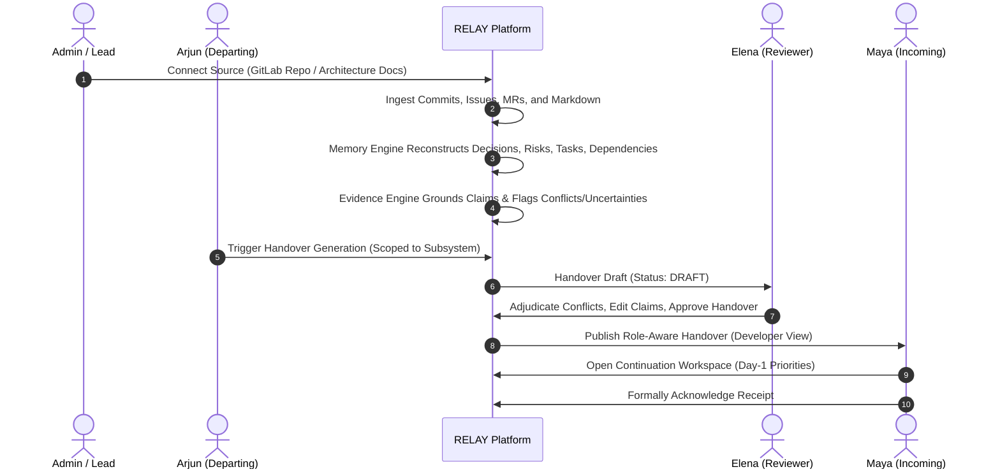

# RELAY — Hackathon Round 1 Submission Document
## Track: Prevent Critical Knowledge From Leaving With People
**Product:** RELAY (Evidence-Backed Project Continuity & Intelligent Handover Platform)  
**Tagline:** *People leave. Project knowledge shouldn't.*

---

## 1. Problem Understanding

Every engineering organization experiences developer turnover. When a developer departs—whether a full-time senior engineer, an open-source contributor, an intern, or a student team member—the organization suffers a "knowledge cliff":
- **The Hidden Rationale Gap:** Source code captures *what* was implemented; git commits rarely capture *why* an alternative was discarded, why a particular architectural pattern was chosen, or what subtle operational constraints exist.
- **The Incomplete Work Trap:** In-progress features, unmerged branches, temporary workarounds, and unresolved bugs often lack context, causing incoming developers to either duplicate work or unknowingly re-introduce previously solved bugs.
- **The Failure of Traditional Handovers:** Exit interviews and hasty wiki documents are rushed, biased by recent memory, ungrounded in repository evidence, and unmaintained.
- **The Danger of Hallucinatory AI:** Generic AI tools (chatbots, document summarizers) generate plausible-sounding summaries that fabricate non-existent facts, confuse conflicting decisions, and leak confidential comments across permission boundaries without citations.

RELAY solves this at the structural level: **Every generated insight is grounded in immutable source evidence, conflicting records are highlighted rather than smoothed over, and human leads review and sign off before an incoming member takes over.**

---

## 2. Target User & Primary Use Case

### Target Audience
1. **Student Project Teams & Academic Labs:** High turnover semester-to-semester where team members graduate or rotate projects, leaving behind fragmented codebases with little to no documentation.
2. **Fast-Growing Startups & Scaleups:** Rapid hiring and role transitions where engineering velocity cannot afford a 3-month ramp-up time for every new engineer.
3. **Open-Source Maintainers:** Volunteer contributors rotating off subsystems, requiring incoming maintainers to rapidly understand historical design trade-offs.

### Primary Demonstration Persona: Project ATLAS
- **Departing Engineer:** Arjun, Lead Developer of the *Atlas* project, who designed the authentication subsystem, opened two unresolved PRs, identified a high-risk database migration table-lock, and discussed a recurring staging deployment issue in issue comments.
- **Incoming Engineer:** Maya, incoming engineer who needs to know immediately what Arjun built, what is unfinished, what risks exist, and what she should work on on Day 1.
- **Reviewer / Engineering Lead:** Elena, who must verify Arjun's handover for accuracy, address conflicting decisions, and officially sign off.

---

## 3. Proposed End-to-End Workflow

---

## 4. Research & Assumptions

> [!NOTE]
> *In compliance with submission guidelines, the following represents theoretical assumptions, industry-observed patterns, and proposed empirical research to be validated during testing.*

### Assumed Baseline Conditions
- **Assumption 1 (Onboarding Latency):** Incoming engineers in small-to-medium teams spend an estimated 3 to 6 weeks reconstructing undocumented architectural context before making their first confident production commit.
- **Assumption 2 (Documentation Decay):** Approximately 60–80% of critical architectural trade-offs reside in fragmented issue comments, PR review threads, and commit messages rather than centralized documentation wikis.
- **Assumption 3 (Trust Deficit in AI):** Technical leads are reluctant to trust purely generative AI summaries for mission-critical handover unless every assertion provides an inspectable citation to git or ticket records.

### Proposed Empirical Validation Plan
- Test RELAY's reconstructed knowledge graph on historical open-source repositories against actual issue resolutions.
- Conduct A/B onboarding trials comparing new developers using conventional READMEs vs. RELAY's Continuation Workspace to measure time-to-first-PR.

---

## 5. Technical Architecture & Stack Selection

- **Frontend:** Next.js 15+ App Router, React 19, TypeScript (strict mode), Tailwind CSS v4, Lucide Icons.
- **Interactive Visualization:** `@xyflow/react` (React Flow) for visual dependency, decision, and risk graphing.
- **Backend & Persistence:** Next.js Server Actions and Route Handlers backed by Supabase PostgreSQL with strict Row Level Security (RLS).
- **Ingestion & Adapters:** Modular `SourceAdapter` interface supporting read-only GitLab REST API and markdown/text document parsers.
- **Analysis Engine:** Provider-independent dual-mode architecture:
  - *Server-Side LLM Engine:* Activates when environment credentials are present.
  - *Deterministic Heuristic Engine:* Operates entirely offline without API keys, ensuring complete hackathon portability and reliability.
- **Evidence Ledger:** First-class database schema linking every claim to source line numbers, commit SHAs, and original URLs.

---

## 6. Privacy, Security & Trust Model

1. **Role-Aware Information Access:** Three distinct roles (`ADMIN`, `REVIEWER`, `INCOMING_MEMBER`). Incoming members cannot view unapproved drafts or restricted internal channels.
2. **Permission Leakage Prevention:** Ingested activities inherit security classifications (`PUBLIC`, `INTERNAL`, `RESTRICTED`, `CONFIDENTIAL`). Generated summaries respect source-level boundaries so confidential details never cross into public summaries.
3. **Untrusted Content Containment:** All repository files and commit messages are parsed strictly as passive data payloads inside delimiter sandboxes to prevent prompt injection.
4. **Transparent Uncertainty:** Claims are categorized with visible status badges (`VERIFIED`, `UNCERTAIN`, `CONFLICTING`, `UNVERIFIED`). The system never fabricates citations or converts guesses into verified facts.

---

## 7. Feasibility & Hackathon Execution Strategy

RELAY is engineered specifically for high feasibility within the hackathon framework:
- **No Third-Party Paid API Dependency:** The application includes a self-contained, deterministic synthetic analysis engine. It runs locally without credit card requirements or rate limit failures.
- **Modular Component Boundaries:** Ingestion, Memory Extraction, Handover Studio, and Continuation Workspace are decoupled through clean TypeScript contracts.
- **Measurable Continuity Index:** Rather than an arbitrary AI score, RELAY calculates project health through transparent metrics (ratio of verified claims, unresolved risks, ownership gaps, pending handovers).

---

## 8. Originality & Competitive Differentiation

| Capability | Generic AI Chatbot | Traditional Wiki / Jira | **RELAY Platform** |
|:---|:---:|:---:|:---:|
| **Evidence Grounding** | Hallucinates sources | Manual linking | **Every claim is hard-linked to git commit/PR line** |
| **Uncertainty Transparency** | Conceals doubts | Ignores unwritten context | **Explicit `CONFLICTING` / `UNCERTAIN` indicators** |
| **Role-Specific Views** | One generic output | Static pages | **Tailored Developer vs PM vs Reviewer views** |
| **Governance & Approval** | None | Ad-hoc sign-off | **Formal Review $\rightarrow$ Approval $\rightarrow$ Acknowledgment** |
| **Day-1 Continuation Plan** | Unstructured bullet points | Backlog dump | **Prioritized actionable radar based on active blockers** |

---

## 9. Phased Development Plan

- **Phase 0 & 1:** Inspection, Architecture, Database Schema, Design System, Dashboard UI, and Round 1 Documentation. *(Completed)*
- **Phase 2:** GitLab REST API and Document Ingestion Adapters.
- **Phase 3:** Memory Reconstruction Engine, Project Timeline, and React Flow Knowledge Graph.
- **Phase 4:** Evidence & Confidence Ledger with Conflict Resolution and Backend RBAC.
- **Phase 5:** Handover Generator, Inline Review Editor, and Version History.
- **Phase 6:** Continuation Workspace and Acknowledgment Workflow.
- **Phase 7:** End-to-End Testing, Access Control Verification, and Final Polish.

---

## 10. Expected Impact

By turning scattered repository activity into verified, permission-aware organizational memory, RELAY:
- Cuts developer onboarding ramp-up time from weeks to hours.
- Eliminates recurring architectural regressions caused by lost context.
- Provides engineering leaders with measurable confidence that no critical project knowledge leaves when a team member walks out the door.
